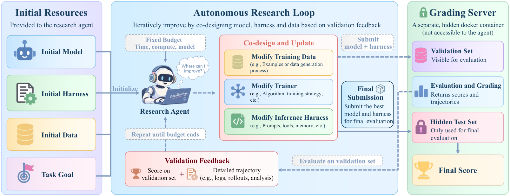

<div align="center">

# VibeTraining-Bench

### Data–Trainer–Harness Co-Design for Iterative System Improvement

Ruotian Peng, Yuanyi Ren, Shuaiqi Liu, Xin Guo, Fang Zhu, Yangyi Huang, Yue Wu, Zheng Wang, Yandong Wen, Zhihang Fu<br>
Zhejiang University · Westlake University · Alibaba Token Hub · South China University of Technology · The Chinese University of Hong Kong

[](https://arxiv.org/abs/2610.26342)
[](https://d2i-ai.github.io/VibeTraining-Bench/index.html)
[](#coming-soon)
[](#coming-soon)

**English** | [中文版](./README.zh-CN.md)

A benchmark for evaluating whether research agents can jointly improve **training data**, the **trainer**, and the **inference harness** — the cross-component co-design capability at the heart of recursive self-improvement.

</div>

---

## Overview

Recursive self-improvement (RSI) requires agents to diagnose system bottlenecks and coordinate improvements across training and inference. We refer to the capability to jointly optimize training data, the trainer, and the inference harness as **cross-component co-design**.

**VibeTraining-Bench** evaluates this capability on tasks spanning terminal operation, software engineering, multi-turn tool use, and mathematical reasoning. Within each task, research agents start from an identical initial agent system under a fixed resource budget. Guided by validation feedback, they iteratively refine data, trainers, and inference harnesses, then select and submit a final agent system for evaluation on the test set.

To prevent reward hacking, the benchmark enforces three safeguards: test data isolation, separate research and grading containers, and network restrictions for research agents.



*Research agents start from shared initial resources under a fixed budget, iteratively co-design data, trainer, and inference harness using validation feedback, and submit the final system for grading on a hidden test set.*

## Highlights

- **Cross-component, not single-component**: agents must co-design data, training, and inference rather than tuning one module in isolation.
- **Controlled comparison**: every research agent starts from the same initial agent system and operates under the same resource budget.
- **Hack-resistant evaluation**: grading is isolated from research, with strict network restrictions during the research phase.
- **Measured gains, visible headroom**: on SWE-bench Verified, the research agent GPT-6-Astra raises the target agent system from 32.9% to 53.7%, comparable to the human-developed instruct model at 55.4% — while cumulative iterative gains remain an open challenge.

## Coming Soon

We are putting the final touches on the open-source release. This repository will contain:

- The VibeTraining-Bench task suite across the four evaluated domains
- The evaluation harness, including the research/grading container separation and network restrictions
- Reference configurations, baseline systems, and results

Watch this repository for the release.

## Citation

If you find this work useful, please cite our paper.

```bibtex
@misc{peng2026vibetrainingbench,
  title         = {VibeTraining-Bench: Data-Trainer-Harness Co-Design for Iterative System Improvement},
  author        = {Ruotian Peng and Yuanyi Ren and Shuaiqi Liu and Xin Guo and Fang Zhu and Yangyi Huang and Yue Wu and Zheng Wang and Yandong Wen and Zhihang Fu},
  year          = {2026},
  eprint        = {2610.26342},
  archivePrefix = {arXiv},
  primaryClass  = {cs.AI}
}
```
